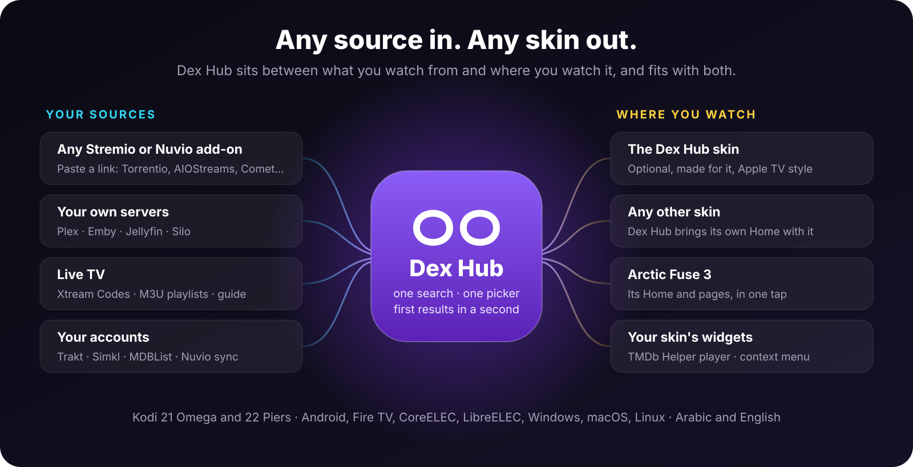

# Dex Hub

**Every source you trust, in any Kodi skin. One search, one picker, play in a second.**

Any Stremio & Nuvio add-on · Plex, Emby, Jellyfin & Silo · Live TV · Native Trakt, Simkl & MDBList · With or without its own skin · Arabic-first UI

[Why Dex Hub](#why-dex-hub) · [Works with](#works-with) · [What's new](#whats-new) · [Screenshots](#screenshots) · [Install](#installation) · [Support](#support-the-project)

## Why Dex Hub

**It takes any add-on as a source.** Paste the link of any Stremio or Nuvio add-on (Torrentio, AIOStreams, Comet, MediaFusion, your own) and it joins the search. Your Plex, Emby, Jellyfin and Silo servers sit in the same picker, next to debrid, Usenet and direct links. No add-on is locked in and none is left out.

**It works in any skin, or with its own.** Dex Hub brings its own Home, title pages and source picker, so it looks the same on Estuary, Arctic Fuse or any other skin. Want more? Turn on the optional Dex Hub skin, or put Dex Hub's Home inside Arctic Fuse 3 in one tap (your skin is backed up first).

**It plays from anywhere in Kodi.** Your skin's TMDb Helper widgets hand playback to Dex Hub with one tap of setup, and every movie and episode in your library gets *Dex Hub: Search sources* in its context menu. It is a subtitle provider for Kodi's own subtitle search too.

**It is fast.** Every source is searched in parallel and the first results show within a second. A one-tap speed profile keeps it smooth on CoreELEC, Fire TV and Zidoo boxes.

**It is yours.** 28 themes, row styles per row, your own covers and fonts, and a phone setup page (scan the QR on the TV) so you never type on the remote.

## Works with

| Sources | | Where you watch | |
| --- | :---: | --- | :---: |
| Any Stremio add-on (link) | ✅ | Dex Hub skin (optional) | ✅ |
| Any Nuvio add-on, or your Nuvio account (QR) | ✅ | Estuary (Kodi default) | ✅ |
| AIOStreams, with its own formatter | ✅ | Arctic Fuse 3 (Home and pages, one tap) | ✅ |
| Plex · Emby · Jellyfin | ✅ | Any other Kodi skin (Dex Hub's own Home) | ✅ |
| Silo | ✅ | TMDb Helper widgets in your skin | ✅ |
| Live TV: Xtream Codes, M3U | ✅ | Library context menu (movies, episodes) | ✅ |
| Trakt · Simkl · MDBList · Floppy | ✅ | Kodi 21 Omega · Kodi 22 Piers | ✅ |
| Fusion, Kaptain and Nuvio collections | ✅ | Android · Fire TV · CoreELEC · LibreELEC · Windows · macOS · Linux | ✅ |

## What's included

| Part | What you get |
| --- | --- |
| **Home** | A spotlight with trailers, Continue Watching and Next Up, your catalogs as rows in the shape you pick (posters, landscape, logo circles…), collections and Live TV |
| **Title page** | Logo, ratings, age rating and studio, episodes with progress, cast, reviews from Trakt and TMDb, pictures and IMDb's Parents Guide |
| **Source picker** | Every result in one list, grouped by type and ranked by quality, language and provider, with Cached / In your account and quality badges |
| **Player** | A rating card as a film starts, a capsule with the video and audio badges, subtitles and audio on one page, Skip intro and recap, auto-play next |
| **Subtitles** | Searched while you pick a source, your languages first (picked by name), AutoSync and AI subtitles |
| **Sync** | Nuvio and Stremio add-ons, progress and library both ways, Trakt scrobbling, and every TV kept in step through DexCloud |
| **Look** | 28 themes, your fonts and text size, Clear Glass and Apple-style focus, your own covers for any collection or catalog |

## What's new

**Dex Hub 5.10.431 · Dex Hub skin 3.28.162**

* **Logo circles:** a new row style for platforms, networks and people, in the Home row style gallery and on the phone page.
* **Languages by name:** pick your subtitle languages (up to three) and audio language from a list, as in Nuvio, instead of typing codes.
* **Subtitles and audio on one page** in the player, with their look and Kodi's own settings beside them.
* **The rating card:** as a film starts, the age rating large, why it got it (from IMDb's Parents Guide), the video, audio and rating, then it slides away.
* **The playback capsule:** a glass pill with the video's badges (4K, Dolby Vision, IMAX), the audio's (Atmos, 7.1.4), codec, bitrate and ratings.
* **Your fonts:** the interface font and its size apart from the subtitles, your own TTF fonts, and font names in Arabic in Kodi's font setting.
* **Cover studio:** choose a cover for any collection, folder or catalog; it stays through refreshes and syncs with your profile.
* **Title page:** Reviews and Pictures rows under the cast, OK on a season opens its episodes, studio logos in white.
* **Next episode:** a finished episode's next one joins Continue Watching, watched episodes no longer come back, and *Remove from Next episode* stays removed.
* **Sync:** Stremio add-ons and progress both ways, and each setting syncs across your TVs on its own (latest change wins, or one TV leads).
* **The Home comes whole:** Dex Hub's screen stays at start until the spotlight and first rows are in, then fades.
* **Kodi 22 fixes:** no more "waiting on thread" hangs from the screensaver, and picking artwork works on CoreELEC.

Version numbers are plain numbers again (5.10.431), as Kodi repositories need. Full history in [changelog.txt](changelog.txt).

## The Dex Hub skin

An optional skin made for Dex Hub. Kodi draws Dex Hub's Home itself, so it opens fast and stays smooth:

* a moving spotlight with trailers that slide the rows down Apple TV style, your Dex Hub rows and collection animations;
* a trailer or a live channel playing behind the whole Home;
* icon tabs, an Edit Home button and per-row styles;
* your Nuvio profile, Dex Hub's title pages, grids and My watching;
* quality badges in the player: Elite, Gold, Minimalist white or your own images;
* Arctic Fuse 3's video player, settings pages and dialogs, from ABUKARIM's copy with his CoreELEC player tools (PPI, Dolby Vision VS10) and Arabic font sets.

Install it from the Dex Hub repository (Look and feel → Skin), or turn it on from Dex Hub's settings with **Home → Dex Hub skin: use it** (it is installed from the repository when missing). **Home → Dex Hub skin: back to the skin used before it** takes you back. The skin needs Kodi 21 or later.

## Screenshots

<table>
  <tr>
    <td align="center"> Title page with episodes, progress and ratings</td>
    <td align="center"> Source picker with Cached status and badges</td>
  </tr>
  <tr>
    <td align="center"> My Library: every service in one place</td>
    <td align="center"> Dex Community: ready made catalogs</td>
  </tr>
  <tr>
    <td align="center"> Collections from your catalogs</td>
    <td align="center"> Spotlight cards for whole catalogs</td>
  </tr>
  <tr>
    <td align="center"> Control centre</td>
    <td align="center"> Cinema screensaver: what's coming this week</td>
  </tr>
  <tr>
    <td align="center"> Player with ratings, badges and your languages</td>
    <td align="center"> Quality badges: pick a pack or bring your own</td>
  </tr>
</table>

> The screenshots are from the Dex Hub skin. In another skin, Dex Hub's own Home and pages look the same; your skin keeps its own menus and player.

## Installation

Dex Hub supports Kodi 21 (Omega) and 22 (Piers) on Android, Linux, Windows, macOS, CoreELEC, LibreELEC and Fire TV. The Dex Hub skin needs Kodi 21 or later.

### From the Dex Hub repository (recommended, updates arrive automatically)

1. In Kodi, go to **Settings → System → Add-ons** and enable **Unknown sources**.
2. Go to **Settings → File manager → Add source**, enter `https://dexworld.cc/dexhub/` and name it **Dex Hub**.
3. Go to **Add-ons → Install from zip file → Dex Hub** and pick the `repository.dexhub` zip.
4. Go to **Add-ons → Install from repository → Dex Hub Repository**, install **Dex Hub** from Video add-ons, then, if you want it, the **Dex Hub** skin from Look and feel → Skin.

### From zip files

Download both zips from the [latest release](../../releases/latest) and install them with **Add-ons → Install from zip file**: first `plugin.video.dexhub`, then `skin.dexhub`. Zip installs don't update themselves, so the repository is the better choice.

On first launch, Quick Start offers three ways in: connect Nuvio, add Stremio add-ons (Cinemeta and Torrentio are good starters), or set things up by hand.

## Quick start

In Dex Hub's Control centre:

* **Add a source:** Accounts & Sources → Add a source → paste a Stremio or Nuvio add-on link
* **Connect Nuvio:** Accounts & Sources → Connect & sync Nuvio
* **Add Live TV:** Accounts & Sources → Live TV (IPTV) → add your Xtream Codes account, or an M3U playlist through IPTV Simple
* **Connect Trakt:** Accounts & Sources → Trakt account & sync
* **Add ready made catalogs:** Home → Dex Community
* **Arrange your Home:** Home → Arrange Home rows
* **Back up your setup:** System → Backup and restore
* **Speed up a slow box:** System → Speed profile, one tap
* **Switch to the Dex Hub skin:** Home → Dex Hub skin: use it
* **Dex Hub inside Arctic Fuse 3:** Home → Dex Hub in Arctic Fuse 3: install or update
* **Choose player badges:** Player → Player badges / Badge pack

## Support the project

Dex Hub is built and maintained by one person in his free time. A big thank you to everyone who has supported it with a donation: you're the reason it keeps getting this much time, and many of the features above came from your suggestions and logs ❤️

If you'd like the updates to keep coming, you can support the project on **[Ko‑fi](https://ko-fi.com/dexworld)**.

Found a bug? Open an [issue](../../issues) and attach your full `kodi.log`. It helps a lot.

## Tech

Built in Python 3 on Kodi's own APIs (xbmc, xbmcgui, xbmcplugin, xbmcvfs), with no required third-party modules. A background service keeps the Home rows, account sync and player info up to date. The Dex Hub skin is plain Kodi skin XML based on Estuary, with Arctic Fuse 3's player and dialogs.

## Credits

* Dex Hub skin: based on Estuary by Team Kodi
* The skin's video player, settings pages and dialogs: Arctic Fuse 3 by jurialmunkey, from ABUKARIM's modified copy with his CoreELEC player tools and Arabic font sets
* Fonts: Inter, IBM Plex Sans Arabic, League Spartan and Font Awesome 6 Free
* Icons: Font Awesome Free and Simple Icons
* Badge packs: [Elite](https://github.com/leonevz/Elite-Badges) by leonevz, [Gold](https://github.com/k45sle/NUVIO_BADGES) by k45sle and [Minimalist white](https://github.com/sweatycab/nuvio-minimalist-badges) by sweatycab, downloaded from their own repositories when you pick them

## Disclaimer

The author of this add-on does not host any of the content which is found and has no affiliation with any of the content providers. The author is in no way affiliated with Kodi, Team Kodi, the XBMC Foundation, Stremio, Nuvio, Plex, Emby, Jellyfin, Silo, Trakt or TMDb.

## License

**Dex Hub (the add-on) is free to use on your own devices, with all rights reserved.** Redistributing it, modifying it, publishing a version based on it or bundling it with a paid service needs written permission. Read the full terms in [LICENSE.txt](LICENSE.txt). Third-party parts keep their own licences ([THIRD-PARTY-NOTICES.txt](THIRD-PARTY-NOTICES.txt)). Versions before 5.10.216 were released under the MIT license.

The Dex Hub skin keeps the licenses of the work it builds on: CC BY-SA 4.0 (Estuary), CC BY-NC-SA 4.0 (Arctic Fuse 3 player) and GPL 2.0.
