

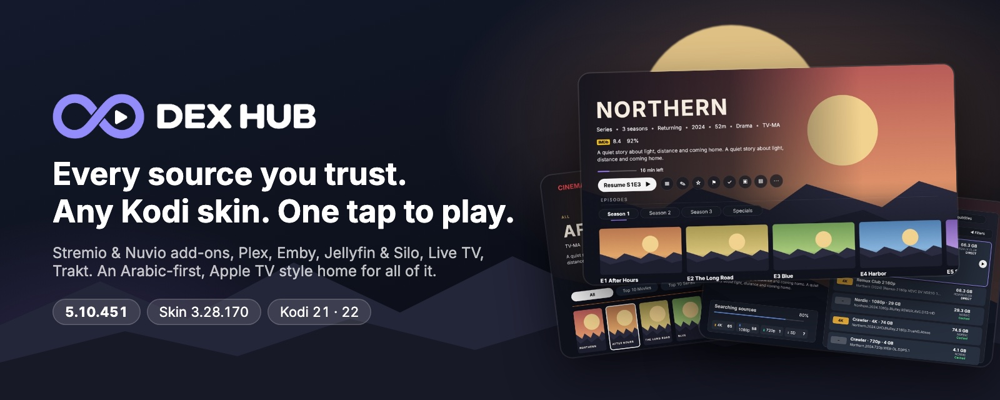

# Dex Hub

**Every source you trust, in any Kodi skin. One search, one picker, play in a second.**

Any Stremio & Nuvio add-on · Plex, Emby, Jellyfin & Silo · Live TV · Native Trakt, Simkl & MDBList · With or without its own skin · Arabic-first UI

[What's new](#whats-new-in-510451) · [Pick your look](#pick-your-look) · [Why Dex Hub](#why-dex-hub) · [Works with](#works-with) · [DexCloud](#dexcloud-your-phone-and-telegram) · [Screenshots](#screenshots) · [Install](#installation) · [Support](#support-the-project)

## What's new in 5.10.451

**Dex Hub 5.10.451 · Dex Hub skin 3.28.170** · a cinema-glass title page, a new player panel for subtitles and audio, and a calmer, clearer Control centre.

<table>
  <tr>
    <td align="center" colspan="2">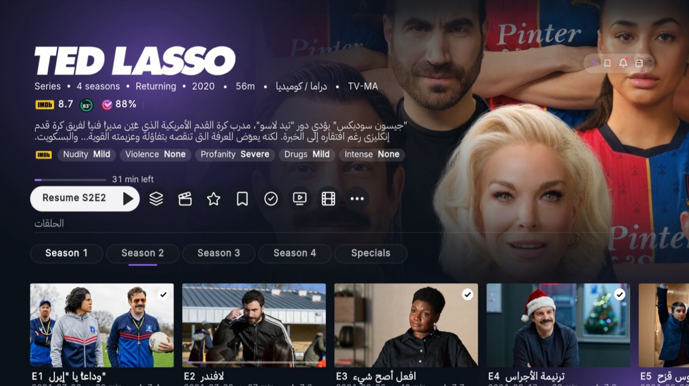 <b>The cinematic title page.</b> The backdrop fills the page, the buttons and seasons sit on dark glass, and one button on the page switches between the cinematic and classic layouts.</td>
  </tr>
  <tr>
    <td align="center" width="50%">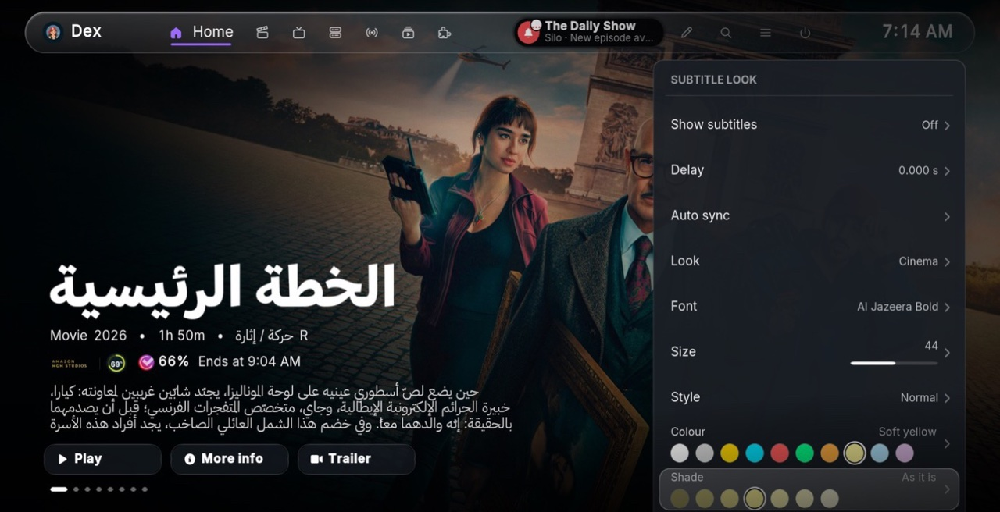 <b>Subtitle look, in the player.</b> Ready colours as swatches, then their shades from darker to lighter, a step at a time.</td>
    <td align="center" width="50%">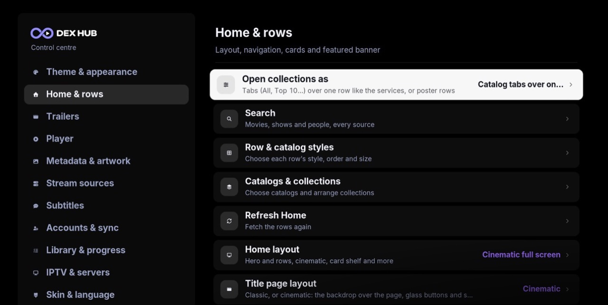 <b>The Control centre, redrawn.</b> Sections on the left, one option a row, real switches, and a Basic mode that shows the essentials first.</td>
  </tr>
</table>

**In the player**
* **One subtitle and audio panel on the right.** Subtitles open on their languages, each with its flag and how many: your languages first, the add-ons' results joining as they arrive, and a language with one subtitle taken at once. Audio lists every track with its flag, details and channel and codec badges.
* **Subtitle look in the same panel:** fonts, size, the ready colours as swatches with a **shade row** (a softer or a stronger yellow), borders, delay and auto sync. Subtitle colours now show at all (Kodi left them out before).
* **Sound settings with Kodi's options:** volume in dB as Kodi shows it, amplification, audio delay and **Allow passthrough**.
* **The quick lists** (resting on the Audio or Subtitles button) share the panel's glass look, and the **Episodes panel** shows the episode number on each picture and says which one is playing.
* **A two-line clock** (the time, and when the video ends) and Arabic text that reads in order.

**Pages and Home**
* **Cinematic title page** in glass: no side card, plain facts, glass buttons and seasons, "Episodes" over a hairline. The classic layout takes the glass too.
* **No leftovers:** a title page opening after another never shows the last title's details or episodes.
* **Collections:** Up, Down and Back from the titles go back to the catalogue tabs.
* **A quicker Home at Kodi's start**, shaped loading cards, and a **Reduce motion** switch for slower boxes.
* **Spotlight buttons** on dark glass, and the loading screen before playback without the extra mark.

**Control centre**
* **Basic and All options:** each section shows its main options first; the last card shows the rest.
* **Pictures for every look** (below) when you choose a title page, a collection view or a sources theme.

**Servers**
* **Silo, the way its team asked:** `/api/v2` only, the client named on every request, sessions renewed with their refresh token (one sign-in per device, never copied between TVs), `429` and `Retry-After` honoured, lighter searches and genres.
* **Silo alerts on Telegram** by a personal Silo webhook to DexCloud 2.17, with no sign-in (your Silo server's admin must allow personal webhooks).

Full history in [changelog.txt](changelog.txt). Earlier: [5.10.449](../../releases/tag/V5.10.449), [5.10.448](../../releases/tag/V5.10.448).

## Pick your look

Every look below is one choice in the Control centre, and the Control centre now shows these pictures as you choose.

<table>
  <tr>
    <td align="center" width="50%">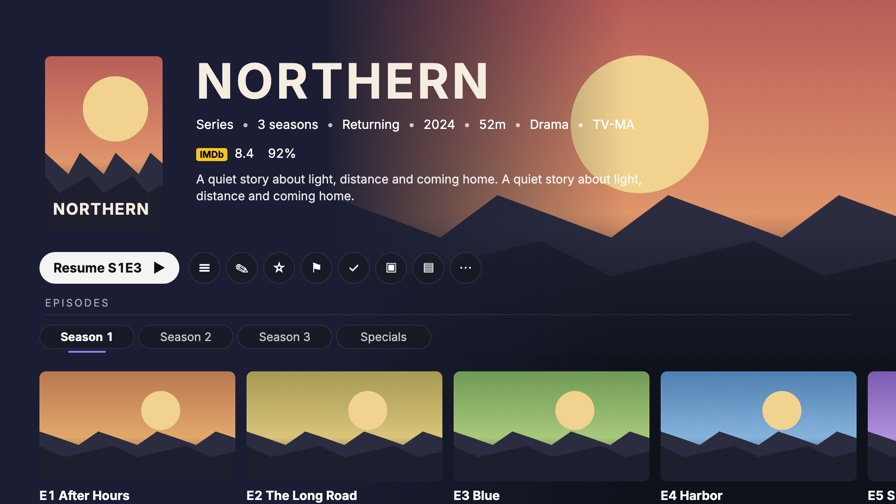 <b>Title page · Classic</b> The poster beside the details, seasons and episodes under them</td>
    <td align="center" width="50%">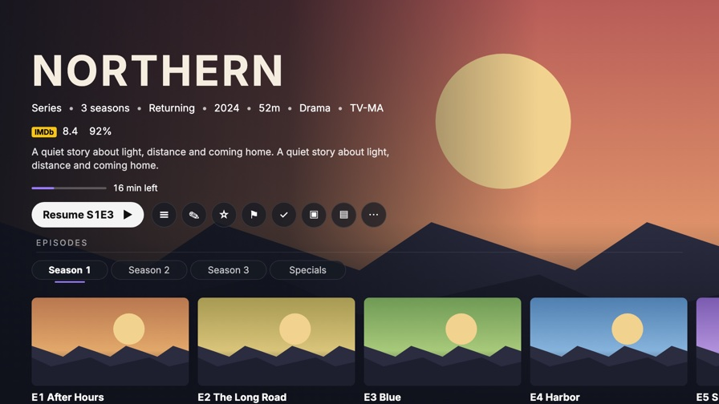 <b>Title page · Cinematic</b> The backdrop over the page, glass buttons, the details on the left</td>
  </tr>
  <tr>
    <td align="center">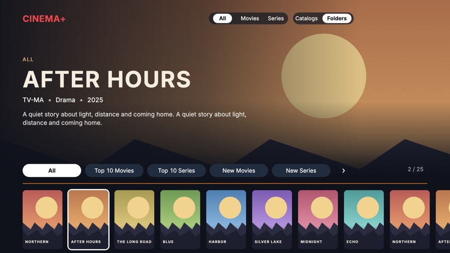 <b>Collections · Tabs</b> Catalogue tabs, the tab's titles in one row under them</td>
    <td align="center">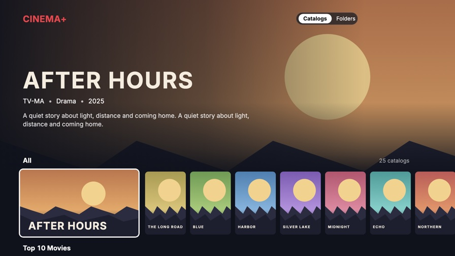 <b>Collections · Rows</b> Every catalogue a row of posters</td>
  </tr>
  <tr>
    <td align="center">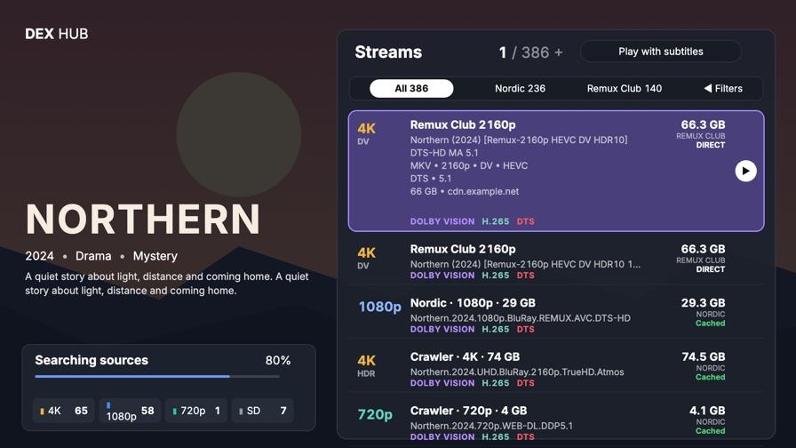 <b>Sources · Prism</b> The add-on's lines in full, the focused row grows</td>
    <td align="center">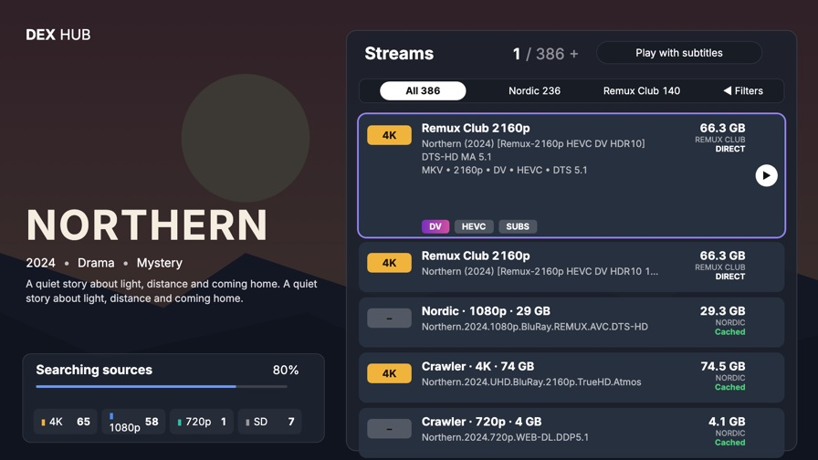 <b>Sources · Halo</b> Ready coloured badges and a gradient ring</td>
  </tr>
  <tr>
    <td align="center" colspan="2">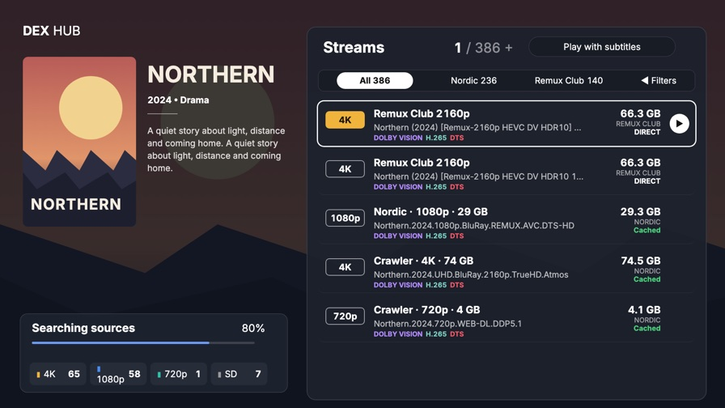 <b>Sources · Compact</b> · short rows with a white focus, your badges</td>
  </tr>
</table>

> These pictures are drawings with made-up titles, so each look is easy to tell apart. The real pages use your titles' own artwork.

## Why Dex Hub

**It takes any add-on as a source.** Paste the link of any Stremio or Nuvio add-on (Torrentio, AIOStreams, Comet, MediaFusion, your own) and it joins the search. Your Plex, Emby, Jellyfin and Silo servers sit in the same picker, next to debrid, Usenet and direct links. No add-on is locked in and none is left out.

**It works in any skin, or with its own.** Dex Hub brings its own Home, title pages and source picker, so it looks the same on Estuary, Arctic Fuse or any other skin. Want more? Turn on the optional Dex Hub skin, or put Dex Hub's Home inside Arctic Fuse 3 in one tap (your skin is backed up first).

**It plays from anywhere in Kodi.** Your skin's TMDb Helper widgets hand playback to Dex Hub with one tap of setup, and every movie and episode in your library gets *Dex Hub: Search sources* in its context menu. It is a subtitle provider for Kodi's own subtitle search too.

**It is fast.** Every source is searched in parallel and the first results show within a second. A one-tap speed profile keeps it smooth on CoreELEC, Fire TV and Zidoo boxes.

**It is yours.** 28 themes, row styles per row, your own covers and fonts, and a phone setup page (scan the QR on the TV) so you never type on the remote.

## Works with

| Sources | | Where you watch | |
| --- | :---: | --- | :---: |
| Any Stremio add-on (link) | ✅ | Dex Hub skin (optional) | ✅ |
| Any Nuvio add-on, or your Nuvio account (QR) | ✅ | Estuary (Kodi default) | ✅ |
| AIOStreams, with its own formatter | ✅ | Arctic Fuse 3 (Home and pages, one tap) | ✅ |
| Plex · Emby · Jellyfin | ✅ | Any other Kodi skin (Dex Hub's own Home) | ✅ |
| Silo (API v2, alerts on Telegram) | ✅ | TMDb Helper widgets in your skin | ✅ |
| Live TV: Xtream Codes, M3U | ✅ | Library context menu (movies, episodes) | ✅ |
| Trakt · Simkl · MDBList · Floppy | ✅ | Kodi 21 Omega · Kodi 22 Piers | ✅ |
| Fusion, Kaptain and Nuvio collections | ✅ | Android · Fire TV · Apple TV · CoreELEC · LibreELEC · Windows · macOS · Linux | ✅ |

## What's included

| Part | What you get |
| --- | --- |
| **Home** | A spotlight with trailers, Continue Watching and Next Up, your catalogs as rows in the shape you pick (posters, landscape, logo circles…), collections and Live TV |
| **Title page** | Classic or cinematic, switched from the page: logo, ratings, age rating and studio, episodes with progress, cast, reviews from Trakt and TMDb, pictures and IMDb's Parents Guide |
| **Source picker** | Every result in one list, grouped by type and ranked by quality, language and provider, with Cached / In your account and quality badges, in three looks |
| **Player** | A rating card as a film starts, video and audio badges, one glass panel for subtitles and audio with flags, Skip intro and recap, auto-play next |
| **Subtitles** | Searched while you pick a source, your languages first (picked by name), ready colours and shades, AutoSync and AI subtitles |
| **Sync** | Nuvio and Stremio add-ons, progress and library both ways, Trakt scrobbling, and every TV kept in step through DexCloud |
| **Look** | 28 themes, your fonts and text size, Clear Glass and Apple-style focus, Reduce motion, your own covers for any collection or catalog |

## DexCloud: your phone and Telegram

DexCloud ([hub.dexworld.cc](https://hub.dexworld.cc)) is Dex Hub's free companion site: link your TVs once, then set them up from your phone or computer.

<table>
  <tr>
    <td align="center" width="50%"> Telegram alerts with Play on Kodi, the trailer and the title's pages</td>
    <td align="center" width="50%"> Play on Kodi: pick a TV and its sources open</td>
  </tr>
  <tr>
    <td align="center" colspan="2"> The ready library: hundreds of folders, each with your cover, name, type and source</td>
  </tr>
</table>

> The Telegram picture above uses a placeholder logo; real alerts use the title's own logo from TMDb.

## The Dex Hub skin

An optional skin made for Dex Hub. Kodi draws Dex Hub's Home itself, so it opens fast and stays smooth:

* a moving spotlight with trailers that slide the rows down Apple TV style, your Dex Hub rows and collection animations;
* a trailer or a live channel playing behind the whole Home;
* icon tabs, an Edit Home button and per-row styles;
* your Nuvio profile, Dex Hub's title pages, grids and My watching;
* quality badges in the player: Elite, Gold, Minimalist white or your own images;
* Arctic Fuse 3's video player, settings pages and dialogs, with CoreELEC player tools and Arabic font sets.

Install it from the Dex Hub repository (Look and feel → Skin), or turn it on from Dex Hub's settings with **Home → Dex Hub skin: use it** (it is installed from the repository when missing). **Home → Dex Hub skin: back to the skin used before it** takes you back. The skin needs Kodi 21 or later.

## Screenshots

<table>
  <tr>
    <td align="center">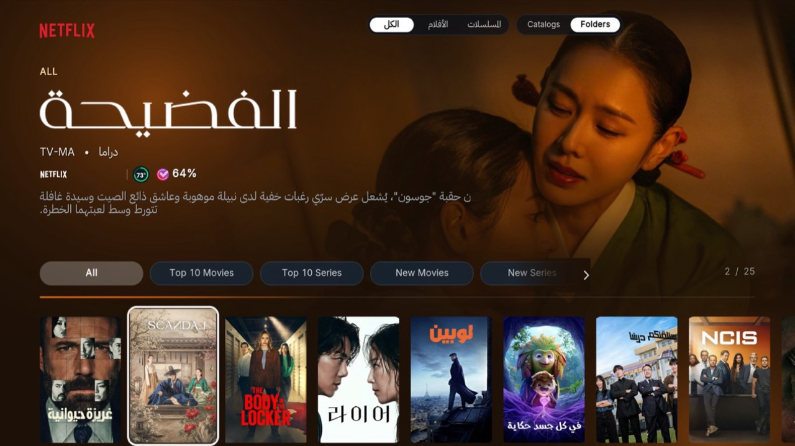 A collection's catalogs as tabs, its titles right under them</td>
    <td align="center"> Dex Hub's own collections as big banners</td>
  </tr>
  <tr>
    <td align="center"> Title page with episodes, progress and ratings</td>
    <td align="center"> Source picker with Cached status and badges</td>
  </tr>
  <tr>
    <td align="center"> Top 10 tabs with large numbers</td>
    <td align="center"> Series pages with a gold star on standout episodes</td>
  </tr>
  <tr>
    <td align="center"> My Library: every service in one place</td>
    <td align="center"> Dex Community: ready made catalogs</td>
  </tr>
  <tr>
    <td align="center"> Collector's Shelf: Remux, Dolby Vision, FEL, Atmos</td>
    <td align="center"> Cinema screensaver: what's coming this week</td>
  </tr>
  <tr>
    <td align="center"> Player with ratings, badges and your languages</td>
    <td align="center"> Quality badges: pick a pack or bring your own</td>
  </tr>
</table>

> The screenshots are from the Dex Hub skin. In another skin, Dex Hub's own Home and pages look the same; your skin keeps its own menus and player.

## Installation

Dex Hub supports Kodi 21 (Omega) and 22 (Piers) on Android, Linux, Windows, macOS, CoreELEC, LibreELEC and Fire TV. The Dex Hub skin needs Kodi 21 or later.

### From the Dex Hub repository (recommended, updates arrive automatically)

1. In Kodi, go to **Settings → System → Add-ons** and enable **Unknown sources**.
2. Go to **Settings → File manager → Add source**, enter `https://dexworld.cc/dexhub/` and name it **Dex Hub**.
3. Go to **Add-ons → Install from zip file → Dex Hub** and pick the `repository.dexhub` zip.
4. Go to **Add-ons → Install from repository → Dex Hub Repository**, install **Dex Hub** from Video add-ons, then, if you want it, the **Dex Hub** skin from Look and feel → Skin.

### From zip files

Download both zips from the [latest release](../../releases/latest) and install them with **Add-ons → Install from zip file**: first `plugin.video.dexhub`, then `skin.dexhub`. Zip installs don't update themselves, so the repository is the better choice.

On first launch, Quick Start offers three ways in: connect Nuvio, add Stremio add-ons (Cinemeta and Torrentio are good starters), or set things up by hand.

## Quick start

In Dex Hub's Control centre (Basic mode shows these first; **All options** at the end of a section shows the rest):

* **Add a source:** Stream sources → Add a source → paste a Stremio or Nuvio add-on link
* **Connect Nuvio:** Accounts & sync → Nuvio sync
* **Add Live TV:** IPTV & servers → add your Xtream Codes account, or an M3U playlist through IPTV Simple
* **Connect Trakt:** Accounts & sync → Trakt
* **Add ready made catalogs:** Home & rows → Catalogs & collections
* **Choose your looks:** Home & rows → Home layout, Title page layout, Open collections as; Stream sources → sources theme
* **Back up your setup:** Maintenance & backup → Backup
* **Speed up a slow box:** Maintenance & backup → Speed mode, and Theme & appearance → Glass & focus → Reduce motion
* **Switch to the Dex Hub skin:** Skin & language → Dex Hub skin

## Support the project

Dex Hub is built and maintained by one person in his free time. A big thank you to everyone who has supported it with a donation: you're the reason it keeps getting this much time, and many of the features above came from your suggestions and logs ❤️

If you'd like the updates to keep coming, you can support the project on **[Ko‑fi](https://ko-fi.com/dexworld)**.

Found a bug? Open an [issue](../../issues) and attach your full `kodi.log`. It helps a lot.

## Tech

Built in Python 3 on Kodi's own APIs (xbmc, xbmcgui, xbmcplugin, xbmcvfs), with no required third-party modules. A background service keeps the Home rows, account sync and player info up to date. The Dex Hub skin is plain Kodi skin XML based on Estuary, with Arctic Fuse 3's player and dialogs.

## Credits

* Dex Hub skin: based on Estuary by Team Kodi
* The skin's video player, settings pages and dialogs: Arctic Fuse 3 by jurialmunkey
* Fonts: Inter, IBM Plex Sans Arabic, League Spartan and Font Awesome 6 Free
* Icons: Font Awesome Free and Simple Icons
* Badge packs: [Elite](https://github.com/leonevz/Elite-Badges) by leonevz, [Gold](https://github.com/k45sle/NUVIO_BADGES) by k45sle and [Minimalist white](https://github.com/sweatycab/nuvio-minimalist-badges) by sweatycab, downloaded from their own repositories when you pick them

## Disclaimer

The author of this add-on does not host any of the content which is found and has no affiliation with any of the content providers. The author is in no way affiliated with Kodi, Team Kodi, the XBMC Foundation, Stremio, Nuvio, Plex, Emby, Jellyfin, Silo, Trakt or TMDb.

## License

**Dex Hub (the add-on) is free to use on your own devices, with all rights reserved.** Redistributing it, modifying it, publishing a version based on it or bundling it with a paid service needs written permission. Read the full terms in [LICENSE.txt](LICENSE.txt). Third-party parts keep their own licences ([THIRD-PARTY-NOTICES.txt](THIRD-PARTY-NOTICES.txt)). Versions before 5.10.216 were released under the MIT license.

The Dex Hub skin keeps the licenses of the work it builds on: CC BY-SA 4.0 (Estuary), CC BY-NC-SA 4.0 (Arctic Fuse 3 player) and GPL 2.0.
